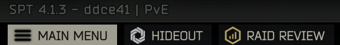

# maschine-RaidReviewOverlay

Opens [Raid Review](https://sp-mod.com/mod/1479/raid-review)'s web interface **in a
window over the game** instead of an external browser tab — same page, same features,
without alt-tabbing out of EFT.

This is a small addon, not a fork: Raid Review does all the work (recording, the
server, the web client). All this does is put its page in an
[Anvil-WebOverlay](https://github.com/maschine34675/WebOverlay) window and redirect
the two places Raid Review opens it from.



## Requirements

- **Raid Review** — its server mod wherever your SPT server runs. Its client plugin
  (`ekky.raidreview`) on your own PC is where the addon learns the address from; without
  it, enter the address yourself (see below) and everything else works the same.
- **Anvil-WebOverlay 1.7.0 or newer** — optional. Without it (or without a WebView2
  runtime) everything falls back to the external browser, exactly like Raid Review on
  its own, so the addon is never worse than not having it.

## Usage

- **F5** (configurable): opens or closes Raid Review over the game. This is Raid
  Review's own key — the addon takes it over, so the press you are used to now shows
  the window instead of a browser tab.
- **Shift+F5**: forces the page into your external browser, ignoring the window.
- **RAID REVIEW** in the bottom menu bar: same as the hotkey.
- **Escape** or the same hotkey closes the window while it has focus.

The window is movable and resizable and remembers its position and size. While it has
focus it takes mouse and keyboard itself; one click into the game gives both back.

## Settings

BepInEx configuration manager (F12), section `maschine-RaidReviewOverlay`. The second
column is the line in `BepInEx\config\com.maschine.RaidReviewOverlay.cfg`.

| In F12 | `.cfg` section / key | Default | What it does |
| --- | --- | --- | --- |
| Overlay Hotkey | `Main` / `Open overlay` | F5 | Shows or hides Raid Review over the game. |
| Browser Hotkey | `Main` / `Open in browser` | Shift+F5 | Forces the external browser. |
| Menu Bar Button | `Main` / `Menu bar button` | on | Adds the RAID REVIEW button to the bottom menu bar, and suppresses Raid Review's own one for the session so there is only one. |
| Web Interface Address | `Server` / `Web interface address` | empty | The address to open, when the automatic one is wrong. See below. |
| Take Over Raid Review's Hotkey | `Integration` / `Take over the Raid Review hotkey` | on | Stops Raid Review from opening a browser tab on its own key. Off means both work: its key opens the browser, this addon's key the window. |
| Show In Overlay Window | `Overlay` / `Use overlay` | on | Off sends every trigger to the external browser. |
| Window Title Bar | `Overlay` / `Window frame` | on | Title bar to drag and resize. Frameless is cleaner but can only be moved from inside the page. Read when the window is first created. |

## What it changes about Raid Review

Both of Raid Review's triggers end in `Application.OpenURL`, which is an internal call
with no IL body — Harmony cannot intercept it at the call site. So the redirect happens
at the triggers instead, and only in memory:

- Its `Open Webpage Keybind` is set to unbound for the session, and this addon adopts
  the key. Raid Review polls that key five times a second and answers every poll with a
  browser tab; taking the key out of the poll is the one place to stop it.
- Its `Insert Menu Item` setting is turned off for the session while this addon's own
  menu button is enabled, so there is one RAID REVIEW button, not two that behave
  differently.

**Raid Review's own config file is never written to.** Both values are restored when the
game closes, and BepInEx's save-on-set is suppressed while they are changed, so
uninstalling this addon leaves Raid Review exactly as it was. Turning either setting off
in the configuration manager restores the corresponding value immediately.

Everything about Raid Review is reached through reflection: this plugin is not built
against `RAID_REVIEW.dll`, so a missing, renamed or newer Raid Review costs a log line,
not a crash.

## Which address it opens

Raid Review's web server is part of its *server* mod, so it listens wherever the SPT
server runs. The address is resolved fresh on every press, in this order:

1. **Web Interface Address**, if you entered one — used as you typed it, and applied on
   the next press. Type the address your browser ends up on: `http://192.168.1.20:7829`,
   or just `192.168.1.20`. A bare host gets what Raid Review would use for it — https
   when its TLS switch is on, and its port setting (none if that is empty) — or http
   on 7829 when its client plugin is not on your PC. IPv6 goes in brackets:
   `[fd00::20]`.
2. **Raid Review's own settings** — its F12 *Server IP*, port and TLS, read live, so a
   correction there counts on the next press. (Raid Review computes its *own* address
   once at game start, so its own F5 needs a restart after such a change; this addon
   does not.) When the Server IP is `127.0.0.1` but this client talks to an SPT server
   on another machine, the server's host is put in its place, keeping scheme and port:
   on a remote setup loopback points at your own PC, where nothing is listening. This
   only ever rewrites loopback; an address pointed somewhere else is left exactly as
   configured.
3. If those settings cannot be read, the address Raid Review computed at game start,
   then its default port on the SPT server's host.

The overlay does not follow a redirect to a different address — `http://` to
`https://`, or to another host. Such a navigation is cancelled, the window stays empty
and the log shows `blocked navigation to …`; enter the final address instead.

Every press logs the address it opened and where it came from, once per change. This
addon's own log lines show any user name and password in an address as `***`, since
they are what people paste into support threads; Anvil-WebOverlay's own warnings
(`blocked navigation to …`, `the page did not load …`) quote the address as it is.

```
[Info   :maschine-RaidReviewOverlay] Raid Review's web interface: http://192.168.1.20:7829/ (from Raid Review's Server IP setting, with the SPT server's host 192.168.1.20 in place of 127.0.0.1).
```

**Enter the address yourself** when the automatic one is wrong — the setups nothing on
your PC can see:

- **Fika headless:** Raid Review's client plugin is often installed only on the headless
  host that records the raids. Without it on your PC there is nothing to read an address
  from, and the addon stays inactive until you enter one — then F5 and the menu bar
  button work right away, with no Raid Review plugin on your PC at all.
- **A public IP for your friends** in Raid Review's Server IP, while you sit in the same
  network as the server: many routers cannot loop a connection to their own public
  address back inside.
- **A server reached through a tunnel**, where even the SPT server's address is
  `127.0.0.1` on your PC.
- **A server port changed** in Raid Review's server `config.json` but not on your PC.

## When the window is not used

The external browser takes over, with a line in the log, when:

- `Overlay / Use overlay` is off, or Shift+F5 was pressed;
- Anvil-WebOverlay is missing or older than 1.7.0;
- the game runs in **exclusive fullscreen** (a window over it would minimise the game —
  borderless works);
- no WebView2 runtime is installed, or the browser process failed. A failure during the
  first press still opens the browser for that press, so no press is lost.

## Building

```
dotnet build RaidReviewOverlay.csproj -c Release
```

Assembly references are relative to the SPT installation two directories up
(`..\..\EscapeFromTarkov_Data\Managed`, `..\..\BepInEx`), so the repository is expected
to live in `<SPT>\Development\RaidReviewOverlay`. The build deploys to
`<SPT>\BepInEx\plugins` as a single DLL; `-p:DeployToSpt=false` skips that.

`scripts\Test-SoftDependency.ps1` verifies the Anvil-WebOverlay soft dependency (rule 5
of the library's `docs/SOFT-DEPENDENCY.md`): no field, base type, interface, generic
argument or method signature may name a library type, and only the gate class may use
them in method bodies.

`scripts\Test-ConfigKeys.ps1` runs every `Config.Bind` section and key name through
BepInEx's own `ConfigDefinition` constructor. BepInEx rejects `= \n \t \ " ' [ ]` there
and throws out of `Awake`, so one apostrophe in a key name keeps the whole plugin from
loading — invisible to the compiler, and only visible on a real game start.

`scripts\Test-AddressRules.ps1` compiles `AddressRules.cs` — the shipped file itself, not
a copy — and runs it against the addresses players type and the setups they run. The
address is the one part of this addon users have reported wrong, and it is pure string
and URI handling, so it is tested without a game.

`scripts\New-ReleasePackage.ps1` builds, runs all three checks and writes the release
archive to `artifacts\`.

`scripts\Test-RaidReviewFields.ps1` checks a `RAID_REVIEW.dll` for the six static
members this addon reflects on — worth running against a new Raid Review release before
assuming this addon still redirects it.

## The button icon

A hexagon with three rising bars, matching the shape and muted gold of the glyphs the
bottom bar already has. `tools\build-icon.py` draws it to `assets\task-bar-icon.png`
(needs Pillow) and the build embeds that PNG in the assembly.

Three details in there were paid for in the game rather than in a preview, and the
script keeps them:

- **Hexagon, not circle.** A ring reads as visibly ragged at the ~24 px the bar gives an
  icon, because a curve that size is all antialiasing.
- **The colour is baked into the PNG.** The button's animator writes `Image.color` every
  frame, so tinting a white glyph from code loses and the icon shows up plain white.
- **The sprite is scaled to the one it replaces.** An `Image` reports its preferred size
  as `sprite.rect.width / sprite.pixelsPerUnit`, so a sprite at the default 100
  pixels-per-unit asks the layout for a much larger glyph — which grows the button and
  leaves the icon floating in the space that opened up.

The icon is this project's own work — no third-party artwork ships with it.

## License

MIT — see [LICENSE](LICENSE).
